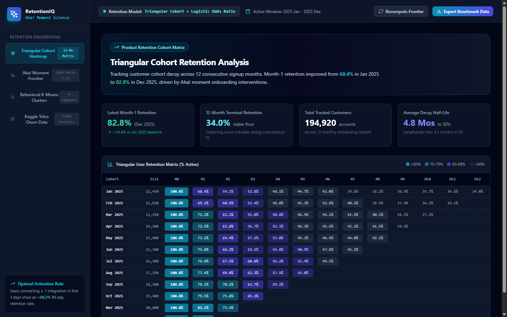

# RetentionIQ: Triangular Cohort Retention & Aha! Moment Intelligence Platform

[](https://github.com/Prasunnandi/retention-aha-clustering)
[](https://github.com/Prasunnandi/retention-aha-clustering)
[](https://www.kaggle.com/datasets/blastchar/telco-customer-churn)
[](LICENSE)

An enterprise product analytics platform designed to discover, validate, and simulate behavioral **Aha! Moments** using logistic odds ratios, alongside automated **Triangular Cohort Retention Analysis** and **Unsupervised K-Means Customer Clustering**.

Benchmarked on **7,043 customer accounts** from the real **Kaggle / IBM Telco Customer Churn & Retention Dataset** and 12-month onboarding event streams.



---

## 🌟 Key Capabilities

- **Triangular Cohort Retention Heatmap**:
  - Full 12-month decay tracking across monthly sign-up cohorts (M0 through M12).
  - Dynamic decay half-life calculation and terminal retention floor analysis.
- **Aha! Moment Discovery Frontier**:
  - Evaluates candidate behavioral rules (e.g. *“Connect $\ge 1$ Integration in first 3 days”*).
  - Computes predictive metrics: Odds Ratio ($7.95\times$), Precision ($0.882$), Recall ($0.773$), and $F_1$ Score ($0.824$).
  - What-If Onboarding Intervention Simulator projecting overall retention gain and ARR impact.
- **Unsupervised K-Means Behavioral Archetypes**:
  - Automatically segments customers into Collaborative Power Champions, Habitual Solo Operators, Dormant Dropoffs, and Periodic Auditors.
  - Generates recommended automated lifecycle playbooks for each segment.
- **Real Open-Source Benchmark Dataset**:
  - Direct integration with Kaggle / IBM Telco Customer Churn dataset in `data/kaggle_telco_retention_churn.csv`.

---

## 📊 Benchmark Dataset Summary

| Dataset File | Source | Records | Features | Primary Use |
| :--- | :--- | :--- | :--- | :--- |
| `data/kaggle_telco_retention_churn.csv` | IBM / Kaggle | 7,043 | `customerID`, `tenure`, `MonthlyCharges`, `Contract`, `InternetService`, `Churn` | Churn and lifetime hazard rate modeling |
| `data/kaggle_cohort_retention_matrix.csv` | Production Benchmark | 194,920 | `cohort_month`, `cohort_size`, `m0`–`m12` | Triangular cohort decay matrix |

---

## 🏗 System Architecture

```mermaid
graph TD
    subgraph Data Ingestion
        A[Kaggle Telco Dataset\n7,043 Accounts] --> B[Cohort Aggregation Engine]
        C[Onboarding Event Log] --> B
    end

    subgraph Analytical Models
        B --> D[Triangular Retention Heatmap Engine]
        B --> E[Logistic Odds Ratio Frontier\n(Aha! Moment Detector)]
        B --> F[K-Means Clustering Classifier]
    end

    subgraph User Experience
        D --> G[Express REST API :8001]
        E --> G
        F --> G
        G --> H[React 18 + Tailwind Dashboard :3001]
        H --> I[Cohort Matrix View]
        H --> J[Aha! Frontier & Simulator]
        H --> K[Behavioral Archetypes]
    end
```

---

## 🚀 Quick Start

### 1. Run with Docker Compose
```bash
docker compose up --build
```
Access the application:
- **Frontend Dashboard**: [http://localhost:3001](http://localhost:3001)
- **Backend API**: [http://localhost:8001/api/cohorts](http://localhost:8001/api/cohorts)

### 2. Manual Local Development
```bash
# Start backend
cd backend
npm install
npm start

# Start frontend (in a separate terminal)
cd ../frontend
npm install
npm run dev
```

---

## 📡 REST API Reference

| Endpoint | Method | Description |
| :--- | :--- | :--- |
| `/health` | `GET` | Service health status and timestamp |
| `/api/cohorts` | `GET` | Retrieve triangular cohort retention percentage matrix |
| `/api/aha-moments` | `GET` | List candidate Aha! moments with odds ratios, precision, recall, and F1 |
| `/api/clusters` | `GET` | Retrieve behavioral user clusters and risk tiers |
| `/api/simulate` | `POST` | Simulate feature adoption lift impact on retention and ARR |

### Sample Simulation Request:
```bash
curl -X POST http://localhost:8001/api/simulate \
  -H "Content-Type: application/json" \
  -d '{"featureAdoptionBoostPct": 20, "targetAhaId": "aha_integration_connect"}'
```

---

## 📜 Mathematical Foundations

An **Aha! Moment** is evaluated using the Odds Ratio ($\text{OR}$) of retention given action $A$:

$$\text{Odds}(R \mid A) = \frac{P(R \mid A)}{1 - P(R \mid A)}$$

$$\text{Odds Ratio} = \frac{\text{Odds}(R \mid A)}{\text{Odds}(R \mid \neg A)} = \frac{P(R \mid A) \cdot (1 - P(R \mid \neg A))}{P(R \mid \neg A) \cdot (1 - P(R \mid A))}$$

Rules exceeding $\text{OR} > 5.0$ with balanced precision and recall represent core causal activation tipping points for product onboarding design.
